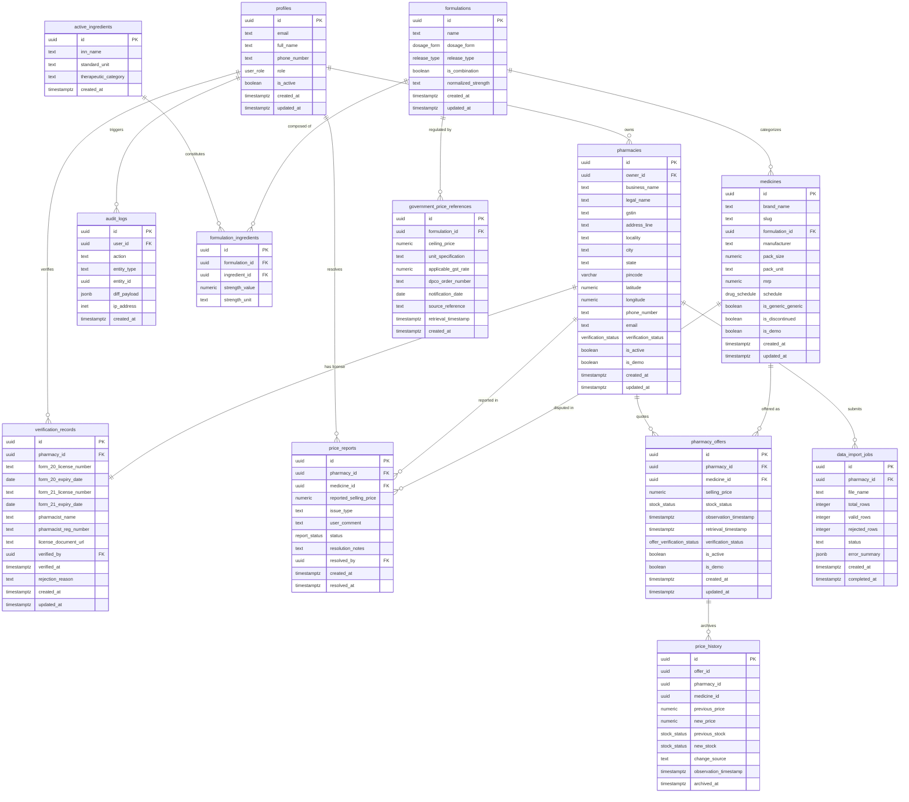

# ENTITY RELATIONSHIP DIAGRAM (ERD)
## MEDICOMPARE INDIA
**Document ID:** `DOC-ERD-001`  
**Task ID:** `MC-006`  
**Author:** AGENT 11 — Database Engineer  
**Reviewer:** AGENT 12 — Security Engineer  
**Status:** `APPROVED`  
**Version:** `1.1.0`  
**Date:** 2026-11-08  

---

## 1. Visual Entity Relationship Diagram (Mermaid)

---

## 2. Relational Cardinalities & Deletion Semantics

| Parent Entity | Child Entity | Cardinality | Delete Cascade Rule | Architectural Rationale |
| :--- | :--- | :--- | :--- | :--- |
| `auth.users` | `profiles` | 1 : 1 | `ON DELETE CASCADE` | Profile exists only while auth user account exists. |
| `profiles` | `pharmacies` | 1 : N | `ON DELETE RESTRICT` | A user account cannot be deleted while it owns an active pharmacy business. |
| `pharmacies` | `verification_records` | 1 : 1 | `ON DELETE CASCADE` | License record is tightly coupled to the specific store entity. |
| `pharmacies` | `pharmacy_offers` | 1 : N | `ON DELETE CASCADE` | If a pharmacy closes or is unlisted, active inventory offers are purged. |
| `formulations` | `medicines` | 1 : N | `ON DELETE RESTRICT` | A clinical formulation cannot be deleted if commercial brand medicines reference it. |
| `medicines` | `pharmacy_offers` | 1 : N | `ON DELETE RESTRICT` | A canonical medicine cannot be deleted while live store quotes exist. |
| `pharmacy_offers` | `price_history` | 1 : N | **TRIGGER-MANAGED** | Uncoupling PK/FK ensures historical price records survive even if parent offers are deleted. |

---

*Authored by Agent 11 (Database Engineer). Ready for Gate 7 Security & RLS Audit by Agent 12 (Security Engineer).*
