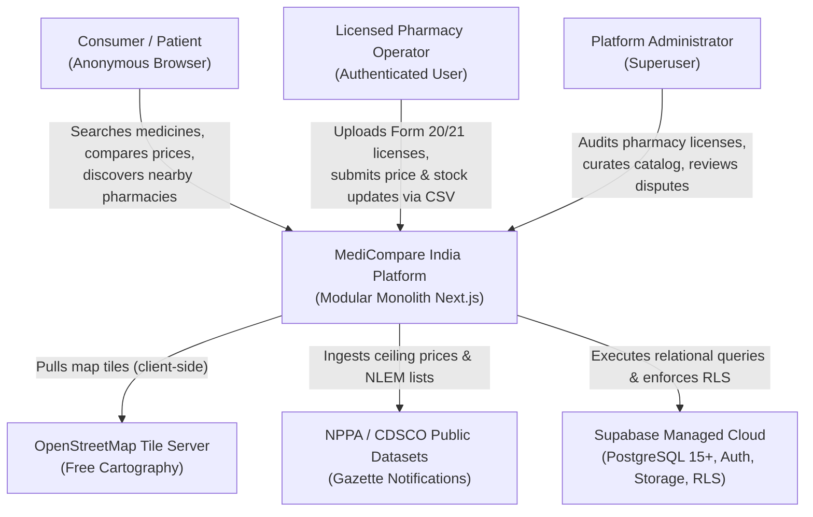
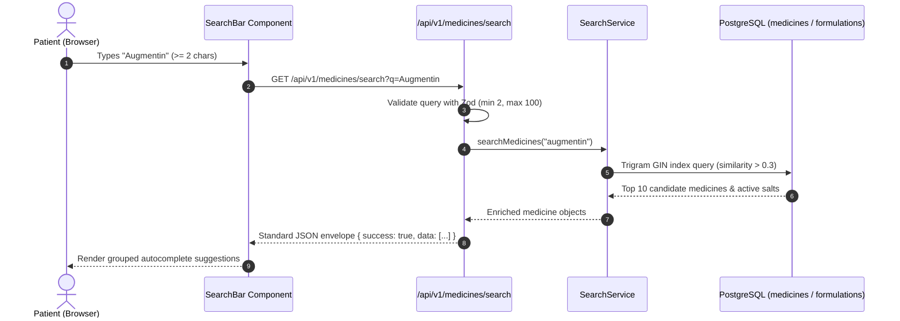
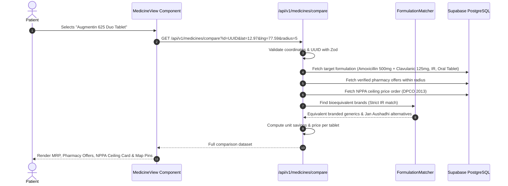

# SYSTEM ARCHITECTURE SPECIFICATION (MODULAR MONOLITH)
## MEDICOMPARE INDIA
**Document ID:** `DOC-ARCH-001`  
**Task ID:** `MC-005`  
**Author:** AGENT 07 — System Architect  
**Reviewers:** AGENT 10 — Backend Engineer & AGENT 11 — Database Engineer  
**Status:** `REVIEW`  
**Version:** `1.0.0`  
**Date:** 2026-11-08  
**Baseline Standard:** IEEE 1471 / ISO/IEC/IEEE 42010 Architecture Description  

---

## 1. Executive Summary & Architectural Philosophy

MediCompare India is engineered as a **Disciplined Modular Monolith** tailored for rapid iteration, extreme reliability, and solo-developer operational maintainability.

### 1.1 Core Architecture Principles
1. **Modular Monolith over Microservices**: All capabilities reside within a single, type-safe Next.js codebase. Modules are decoupled logically through strict internal boundaries and TypeScript contracts, avoiding distributed latency, network partitions, and Kubernetes maintenance overhead.
2. **Strict Layered Dependency Flow**: Dependencies strictly flow inward:
   `Presentation (React Components) -> Application Layer (Route Handlers) -> Domain Services -> Data Access (Supabase Client / PostgREST)`.
3. **Data Provenance & Price Integrity by Design**: Physical separation of Government Reference Prices (NPPA), Manufacturer MRP, Verified Pharmacy Selling Prices, and Immutable Price History.
4. **Zero-Trust Privacy & Security**: 100% of database tables protected by Supabase Row Level Security (RLS). Anonymous consumer search with zero persistent geolocation storage.

---

## 2. System Context (C4 Level 1)



---

## 3. Container Architecture (C4 Level 2)

```mermaid
flowchart TD
    subgraph ClientBrowser["Client Web Browser (Desktop / Mobile 360px+)"]
        RSCShell["React Server Components Shell<br/>(Zero client JS overhead)"]
        InteractiveUI["Client Islands<br/>(Search bar, Comparison table, Leaflet map drawer)"]
    end

    subgraph VercelEdge["Vercel Production Edge & Compute"]
        AppRouter["Next.js App Router (15+)<br/>• / (Home / Search)<br/>• /medicines/[slug] (Details)<br/>• /pharmacy/* (Portal)<br/>• /admin/* (Governance)"]
        
        subgraph ServerlessRouteHandlers["RESTful Route Handlers (/api/v1/...)"]
            SearchAPI["/api/v1/medicines/search"]
            CompareAPI["/api/v1/medicines/compare"]
            GeoAPI["/api/v1/pharmacies/nearby"]
            PharmAPI["/api/v1/pharmacies/inventory"]
            ReportAPI["/api/v1/reports/price"]
            AdminAPI["/api/v1/admin/*"]
        end

        subgraph CoreDomainServices["Core Domain Services (src/lib/server/services/)"]
            SearchService["Search & Trigram Service"]
            MatcherEngine["Formulation Matching Engine"]
            PriceEngine["Price Normalization Engine"]
            GeoEngine["Spatial Haversine Engine"]
            CSVService["CSV Batch Ingestion Engine"]
            AuditService["Audit & Compliance Service"]
        end
    end

    subgraph SupabasePlatform["Supabase Managed PostgreSQL (Strict RLS)"]
        CatalogDB[("medicines<br/>formulations<br/>active_ingredients")]
        PricingDB[("pharmacy_offers<br/>government_price_references<br/>price_history")]
        PharmacyDB[("pharmacies<br/>verification_records")]
        GovDB[("audit_logs<br/>price_reports")]
    end

    ClientBrowser -->|"HTTPS / TLS 1.3"| AppRouter
    AppRouter --> ServerlessRouteHandlers
    ServerlessRouteHandlers --> CoreDomainServices
    CoreDomainServices -->|"PostgREST / Supabase Client (Parameterised SQL)"| SupabasePlatform
```



---

## 4. Internal Component Boundaries & Modular Directory Structure

```text
c:\Users\veere\Desktop\Med compare\
├── src/
│   ├── app/                               # Next.js App Router
│   │   ├── (public)/                      # Consumer facing routes
│   │   │   ├── layout.tsx                 # Root layout with Statutory Header/Footer
│   │   │   ├── page.tsx                   # Landing & Search Interface
│   │   │   └── medicines/[slug]/page.tsx  # Comparison & Nearby Pharmacy View
│   │   ├── pharmacy/                      # Pharmacy Portal routes
│   │   │   ├── register/page.tsx          # Form 20/21 Onboarding
│   │   │   └── dashboard/page.tsx         # Inventory & Price Management
│   │   ├── admin/                         # Administrator routes
│   │   │   ├── verifications/page.tsx     # License Approval Queue
│   │   │   └── catalog/page.tsx           # Master Catalog Curation
│   │   └── api/v1/                        # Serverless REST Route Handlers
│   │       ├── medicines/search/route.ts
│   │       ├── medicines/compare/route.ts
│   │       ├── pharmacies/nearby/route.ts
│   │       ├── pharmacies/inventory/route.ts
│   │       └── reports/price/route.ts
│   ├── components/                        # UI Presentation Components
│   │   ├── ui/                            # shadcn/ui primitives (Button, Dialog, Table)
│   │   ├── layout/                        # StatutoryBanner, NavHeader, Footer
│   │   ├── search/                        # SearchBar, SearchResults, RadiusFilter
│   │   ├── medicine/                      # MedicineHeader, RxBadge, SaltComposition
│   │   ├── pricing/                       # PriceBreakdown, PharmacyOfferCard, NppaReferenceCard
│   │   └── map/                           # PharmacyMap (Leaflet dynamic import)
│   └── lib/                               # Business Logic & Infrastructure
│       ├── server/                        # Server-Only Modules (Never in client bundle)
│       │   ├── db/                        # Supabase server client (Service Role & User)
│       │   └── services/                  # Domain Services (Search, Compare, Geo, Ingest)
│       ├── matching/                      # Clinical & Formulation Match Algorithms
│       │   ├── formulationMatcher.ts      # Active salt & release profile equivalence
│       │   ├── entityResolver.ts          # Brand/salt tokenization
│       │   └── priceNormalizer.ts         # Unit pricing calculations
│       └── validations/                   # Zod Schemas (Runtime validation)
│           ├── searchSchema.ts
│           ├── pharmacySchema.ts
│           └── csvRowSchema.ts
├── supabase/
│   ├── migrations/                        # SQL DDL & RLS Policies
│   └── seed.sql                           # Seed data (Clearly flagged is_demo = true)
```

---

## 5. End-to-End Data Flow Architecture

### 5.1 Patient Medicine Search & Autocomplete Flow


### 5.2 Exact Formulation Resolution & Price Comparison Flow


---

## 6. Cross-Cutting Concerns & Security Controls

### 6.1 Data Provenance & Dataset Separation
The architecture enforces physical table isolation for price datasets:
1. `government_price_references`: Sourced from official NPPA gazettes (NLEM 2022). Read-only for public. Never displayed as a pharmacy offer.
2. `medicines.mrp`: Manufacturer packaging maximum retail price.
3. `pharmacy_offers`: Verified store quotations submitted by licensed chemists. Must satisfy `selling_price <= mrp`.
4. `price_history`: Immutable audit trail populated exclusively via PostgreSQL triggers before any offer mutation.

### 6.2 Supabase Row Level Security (RLS) Policy Architecture
- **Public / Anon Role**:
  - `SELECT` permitted on `medicines`, `formulations`, `government_price_references`, and `pharmacy_offers` WHERE `verification_status = 'PHARMACY_CONFIRMED'`.
  - Zero `INSERT`, `UPDATE`, or `DELETE` permissions.
- **Authenticated Pharmacy Role**:
  - `SELECT`, `INSERT`, `UPDATE`, `DELETE` on `pharmacy_offers` and `inventory` WHERE `pharmacy_id = auth.uid()`.
- **Admin Role**:
  - Full access to `verification_records`, `audit_logs`, and master catalog curation via secure service role client in server Route Handlers.

### 6.3 Spatial Mapping & Performance
- **Leaflet SSR Isolation**: To prevent SSR hydration crashes (`window is not defined`), `PharmacyMap` is dynamically imported using `next/dynamic` with `{ ssr: false }`.
- **Haversine Distance**: Server computes distance in kilometers using spherical law of cosines in SQL:
  ```sql
  (6371 * acos(cos(radians($lat)) * cos(radians(latitude)) * cos(radians(longitude) - radians($lng)) + sin(radians($lat)) * sin(radians(latitude)))) AS distance_km
  ```
  Bounding box pre-filtering (`latitude BETWEEN min_lat AND max_lat`) ensures index utilization before trigonometric evaluation.

---

*Authored by Agent 07 (System Architect). Ready for Gate 2 Review by Agent 10 (Backend Engineer) and Agent 11 (Database Engineer).*
