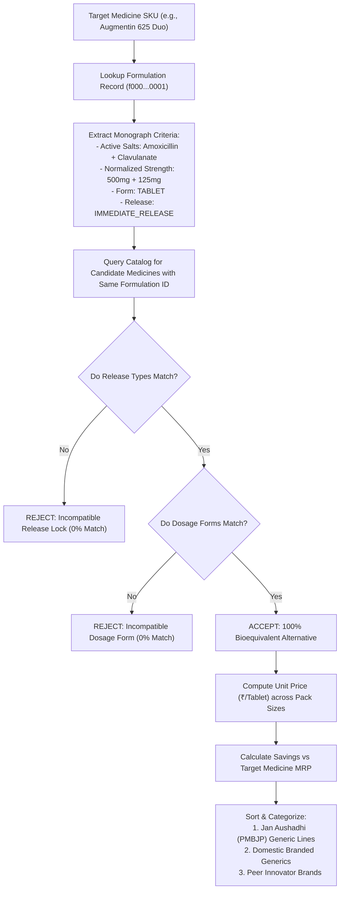

# FORMULATION MATCHING & BIOEQUIVALENCE ENGINE SPECIFICATION
## MEDICOMPARE INDIA — CLINICAL MONOGRAPH & GENERIC RESOLUTION ENGINE
**Document ID:** `DOC-DATA-002`  
**Task ID:** `MC-008`  
**Author:** AGENT 06 — Data Quality & Matching & AGENT 07 — System Architect  
**Reviewer:** AGENT 12 — Security Engineer  
**Status:** `APPROVED`  
**Version:** `1.0.0`  
**Date:** 2026-11-08  
**Applicability:** Clinical Formulation Matching, Bioequivalence Resolution, and Safety Lock Enforcement  

---

## 1. Executive Summary & Clinical Safety Mandate

In the Indian pharmaceutical market, medicines are prescribed under commercial brand names (e.g., *Augmentin 625 Duo*, *Telma 40*, *Glycomet 500*), branded generics (e.g., *Moxikind-CV 625*, *Telmikind 40*), or public generic names (e.g., *Jan Aushadhi Amoxy-Clav 625*).

> [!CAUTION]
> **Cardinal Safety Guardrail (Governance Rule 02)**:
> Therapeutic equivalence must **NEVER** be inferred solely from name similarity or approximate salt composition. Recommending an incompatible drug or incorrect release profile (e.g., swapping Immediate Release with Sustained Release) carries life-threatening clinical risks (e.g., sudden hypoglycemia or hypertensive crisis).

MediCompare's Formulation Matching Engine operates as a deterministic, multi-dimensional clinical classifier that guarantees bioequivalence before presenting any medicine as a direct substitute.

---

## 2. Bioequivalence Invariants & Equivalence Criteria

Two commercial medicine SKUs ($M_A$ and $M_B$) are defined as **Bioequivalent Direct Substitutes** ($M_A \equiv M_B$) if and only if all five clinical dimensions match identically:

```
┌────────────────────────────────────────────────────────────────────────┐
│                   BIOEQUIVALENCE EQUIVALENCE MATRIX                    │
└───────────────────────────────────┬────────────────────────────────────┘
                                    │
    ┌───────────────────────────────┼───────────────────────────────┐
    ▼                               ▼                               ▼
1. ACTIVE INGREDIENTS       2. NORMALIZED STRENGTHS         3. DOSAGE FORM
   Exact match of INN salts    Identical metric value          Tablet == Tablet
   (e.g., Amoxicillin +        (e.g., 500mg + 125mg ==         Capsule == Capsule
    Clavulanic Acid)            500mg + 125mg)                 Syrup != Tablet
    │                               │                               │
    └───────────────────────────────┼───────────────────────────────┘
                                    │
    ┌───────────────────────────────┴───────────────────────────────┐
    ▼                                                               ▼
4. RELEASE CHARACTERISTIC                                   5. COMBINATION ORDER
   IR == IR (Immediate Release)                                Bridge composition
   SR == SR (Sustained Release)                                match across all
   SR != IR (Strictly Incompatible!)                           active ingredients
```

### 2.1 The Five Invariant Checks:
1. **Active Pharmaceutical Ingredients (APIs)**:
   - Normalized International Nonproprietary Names (INN) must be identical:
     $$\text{Ingredients}(M_A) = \text{Ingredients}(M_B)$$
2. **Normalized Strength & Metric Units**:
   - Every active component must possess the exact same numerical strength and normalized unit (mg, mcg, ml, %, IU):
     $$\text{Strength}(M_A, I_k) = \text{Strength}(M_B, I_k) \quad \forall k$$
3. **Dosage Form**:
   - `dosage_form` must match (`TABLET` $\leftrightarrow$ `TABLET`, `CAPSULE` $\leftrightarrow$ `CAPSULE`).
   - A `TABLET` and a `SUSPENSION` are **not** bioequivalent substitutes even if they contain identical salts.
4. **Release Profile Lock**:
   - `release_type` must match identically:
     $$\text{release\_type}(M_A) == \text{release\_type}(M_B)$$
   - *Example*: **Glycomet 500** (`IMMEDIATE_RELEASE`) and **Glycomet-SR 500** (`SUSTAINED_RELEASE`) share the same salt and strength (Metformin 500mg), but are classified under **two distinct formulations** (`f000...002` vs `f000...003`). The engine forbids cross-matching them.
5. **Fixed-Dose Combination (FDC) Integrity**:
   - In multi-salt formulations (e.g., Telmisartan 40mg + Amlodipine 5mg), all ingredients must match. A single-salt Telmisartan 40mg is never matched as an alternative for Telmisartan + Amlodipine.

---

## 3. Algorithm Architecture & TypeScript Engine

The engine is implemented in `src/lib/matching/` as a modular, pure TypeScript domain service:
- `formulationMatcher.ts`: Evaluates formulation equivalence and release locks.
- `priceNormalizer.ts`: Calculates unit economics ($\text{₹/tablet}$) across heterogeneous packaging formats.
- `bioequivalenceRanker.ts`: Ranks candidate alternatives by consumer savings.



---

## 4. Price Normalization & Unit Calculation Logic

Commercial packaging varies widely across manufacturers:
- **Augmentin 625 Duo**: Strip of 10 tablets $\rightarrow$ MRP ₹223.50 ($\text{₹22.35 / tablet}$)
- **Telma 40**: Strip of 15 tablets $\rightarrow$ MRP ₹142.50 ($\text{₹9.50 / tablet}$)
- **Telmikind 40**: Strip of 10 tablets $\rightarrow$ MRP ₹78.00 ($\text{₹7.80 / tablet}$)
- **Jan Aushadhi Telmisartan 40**: Strip of 10 tablets $\rightarrow$ MRP ₹18.00 ($\text{₹1.80 / tablet}$)

### 4.1 Mathematical Formulas
1. **Unit Price**:
   $$\text{UnitPrice} = \frac{\text{PackPrice}}{\text{PackSize}}$$
2. **Normalized Cost Comparison for Standard Course (e.g. 30 days)**:
   $$\text{MonthlyCost} = \text{UnitPrice} \times 30$$
3. **Absolute Consumer Savings**:
   $$\text{AbsoluteSavings} = (\text{TargetUnitPrice} - \text{AlternativeUnitPrice}) \times \text{UnitsPurchased}$$
4. **Percentage Savings**:
   $$\text{PercentageSavings} = \left( \frac{\text{TargetUnitPrice} - \text{AlternativeUnitPrice}}{\text{TargetUnitPrice}} \right) \times 100$$

---

## 5. Alternative Categorization & Ranking

When a user searches for an expensive brand, the engine organizes alternatives into three clear consumer categories:

### 5.1 Category 1: Public Generic Baseline (Jan Aushadhi / PMBJP)
- **Flag**: `is_generic_generic = true`
- **Typical Savings**: **60% to 90% below commercial brand MRP**.
- **Display Badge**: `Government Generic (Jan Aushadhi)`

### 5.2 Category 2: Domestic Branded Generics
- **Examples**: Mankind, Alkem, Torrent, Micro Labs, Cipla.
- **Typical Savings**: **20% to 50% below innovator MRP**.
- **Display Badge**: `Branded Generic Alternative`

### 5.3 Category 3: Peer Commercial Innovator Brands
- **Examples**: GSK, Abbott, Pfizer, Sanofi.
- **Typical Savings**: 0% to 15% (competitive market parity).

---

## 6. Safety Warnings & Prescription Guardrails

For all medicines classified as **Schedule H**, **Schedule H1**, or **Schedule X** under the Drugs and Cosmetics Rules, 1945:
1. **Rx Badge**: Display amber `Rx Required` badge on all alternative cards.
2. **Doctor Consultation Disclaimer**:
   > *"Bioequivalent medicines share identical active ingredients, strength, and release profile. However, always consult your prescribing doctor or qualified pharmacist before substituting maintenance or critical medications."*
3. **Release Profile Warning**: If a user attempts to view a sustained-release variant of an immediate-release drug, display a persistent red warning:
   > *"Caution: This medicine has a Sustained Release (SR) mechanism and releases medication slowly over time. It cannot be substituted for an Immediate Release formulation without a doctor's explicit prescription."*

---

*Authored by Agent 06 (Data Quality) and Agent 07 (System Architect). Approved by Agent 12 (Security Engineer).*

