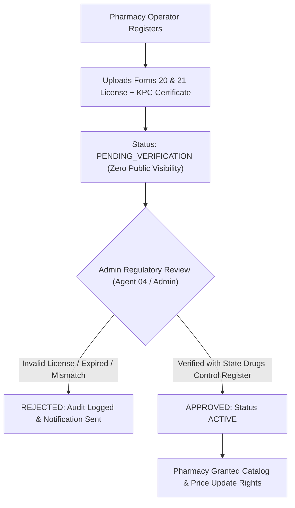

# MEDICOMPARE INDIA — REGULATORY BOUNDARY & LEGAL COMPLIANCE FRAMEWORK
**Document ID:** `DOC-REG-001`  
**Task ID:** `MC-002`  
**Author:** AGENT 04 — Regulatory and Compliance  
**Reviewer:** AGENT 12 — Security Engineer  
**Status:** `APPROVED`  
**Date:** 2026-11-08  
**Approved By:** AGENT 12 — Security Engineer (Gate 7 & Gate 8 Sign-off)  
**Statutory Scope:** Drugs and Cosmetics Act (1940), Drugs & Cosmetics Rules (1945), DPDP Act (2023), Pharmacy Act (1948), DMRA (1954)  

---

## 1. Executive Summary & Legal Classification

MediCompare India operates strictly as an **informational search, price comparison, and nearby pharmacy discovery engine**. It bridges the information asymmetry between Indian healthcare consumers and local licensed brick-and-mortar retail chemists.

### 1.1 Statutory Non-Dispensing Boundary
MediCompare India:
- **Does NOT** buy, sell, stock, barter, dispense, compound, or distribute prescription medications.
- **Does NOT** operate an e-pharmacy warehouse, dark store, or courier fulfillment network.
- **Does NOT** process payment transactions for medicine sales or handle checkout fulfillment.
- **Does NOT** substitute prescribed medications or practice telemedicine or medicine.

All actual dispensing and commercial transactions occur **physically at licensed retail chemist counters** in strict compliance with the *Drugs and Cosmetics Rules, 1945*, following the inspection of an original physical prescription by a Registered Pharmacist.

---

## 2. Indian Pharmaceutical Regulatory Framework

```
┌─────────────────────────────────────────────────────────────────────────┐
│               INDIAN STATUTORY HEALTHCARE GOVERNANCE                    │
└────────────────────────────────────┬────────────────────────────────────┘
                                     │
         ┌───────────────────────────┼───────────────────────────┐
         ▼                           ▼                           ▼
┌──────────────────┐       ┌──────────────────┐       ┌──────────────────┐
│ DRUGS & COSMETICS│       │    PHARMACY ACT  │       │     DPDP ACT     │
│  ACT, 1940 &     │       │       1948       │       │       2023       │
│   RULES, 1945    │       │                  │       │                  │
├──────────────────┤       ├──────────────────┤       ├──────────────────┤
│• Forms 20 & 21   │       │• Reg Pharmacist  │       │• Data Principal  │
│  retail licences │       │  supervision     │       │  privacy rights  │
│• Sched H/H1/X Rx │       │  (Sec 42)        │       │• Anonymous search│
│• Rule 65 sale    │       │• State Pharmacy  │       │  by default      │
│  conditions      │       │  Council cert    │       │• Zero health PII │
└──────────────────┘       └──────────────────┘       └──────────────────┘
```

### 2.1 Retail Pharmacy Licensing (Drugs and Cosmetics Rules, 1945)
Under Part VI of the *Drugs and Cosmetics Rules, 1945*, participating pharmacies in MediCompare's network must hold valid, unexpired licenses issued by the relevant State Licensing Authority (e.g., Karnataka State Drugs Control Department):

| License Form | Statutory Coverage | Relevance to MediCompare Network |
| :--- | :--- | :--- |
| **Form 20** | License to sell, stock, or exhibit or offer for sale, or distribute drugs other than those specified in Schedules C, C(1), and X. | **Mandatory** for any retail pharmacy onboarded. |
| **Form 21** | License to sell, stock, or exhibit or offer for sale, or distribute drugs specified in Schedules C and C(1) (biologicals, injectables, serums, vitamins). | **Mandatory** for general retail pharmacies handling antibiotics and injectables. |
| **Form 20F / 21F** | Retail sale of drugs specified in Schedule X (psychotropics/narcotics). | Optional / Flagged. MediCompare **excludes Schedule X drugs** from promotional discovery to prevent regulatory abuse. |
| **Form 20B / 21B** | Wholesale drug licenses. | **Excluded**. MediCompare serves retail end-consumers; wholesale premises cannot dispense direct-to-patient under standard retail rules. |

### 2.2 Prescription Schedules & Rule 65 Compliance

| Drug Schedule | Statutory Constraints | MediCompare UI & Search Governance |
| :--- | :--- | :--- |
| **Schedule H** | Must be sold by retail only on and in accordance with the prescription of a Registered Medical Practitioner (RMP). Container labeled with "Rx" and red vertical box. | Display prominent **"Rx Required"** warning badge. Display mandatory notice: *"A valid physical prescription from a licensed doctor is required at the pharmacy counter."* |
| **Schedule H1** | High-risk antibiotics, anti-TB, and psychotropic substances. Retailer must maintain a separate register recording patient name, doctor, and drug details for 3 years. | Display prominent **"Schedule H1 — Physical Prescription & Identity Required"** warning. Price comparison permitted for informational transparency; substitution warnings enforced. |
| **Schedule X** | Barbiturates, amphetamines, and potent narcotics. Retailer must retain copy of prescription for 2 years. | **Zero Promotional Highlighting**. Must be marked with red security warnings. Banned from unverified user search autocomplete. |
| **Non-Scheduled / OTC** | General home remedies, antacids, multivitamins, paracetamol preparations. | General pricing and local pharmacy availability displayed with standard retail freshness disclaimers. |

### 2.3 Drugs and Magic Remedies (Objectionable Advertisements) Act, 1954
- **Section 3 & 4 Prohibitions**: Prohibits any advertisement, claim, or communication suggesting that a drug or product cures, mitigates, or prevents any disease specified in the Schedule (e.g., cancer, diabetes, epilepsy, kidney disease).
- **MediCompare Guardrail**:
  1. The platform must **NEVER** use language claiming that a lower-cost medicine will "cure" or "treat" disease better.
  2. Search interfaces must index strictly by **Chemical Formulation / Generic Salt Name** and **Registered Brand Trade Names**, with zero therapeutic or promotional marketing text.

---

## 3. Mandatory Customer Disclaimers Package

Every view within MediCompare India must integrate standardized statutory disclaimers designed by Agent 04 and enforced by Agent 08 (UI/UX) and Agent 09 (Frontend):

### Disclaimer 1: Persistent Global Header / Footer Disclaimer
> **Statutory Notice**: MediCompare India is an independent informational medicine price comparison and pharmacy discovery platform. MediCompare is not a licensed pharmacy, does not sell or deliver prescription medications, and does not provide medical or clinical advice. All displayed prices and stock levels are verified estimates provided by independent licensed pharmacies and government reference databases. Physical purchase of Schedule H, H1, or X medications requires an original, valid physical prescription issued by a Registered Medical Practitioner presented directly at a licensed retail chemist counter.

### Disclaimer 2: Prescription Medicine Formulation Badge (Schedule H & H1)
```
┌────────────────────────────────────────────────────────────────────────┐
│  ⚠️ PRESCRIPTION REQUIRED (SCHEDULE H / H1 MEDICINE)                   │
│  This medicine cannot be dispensed without a valid, original physical  │
│  prescription from a Registered Medical Practitioner (RMP). You will   │
│  be required to present this prescription to the pharmacist at pickup. │
│  MediCompare does not dispense medications.                            │
└────────────────────────────────────────────────────────────────────────┘
```

### Disclaimer 3: Formulation Bioequivalence & Non-Substitution Notice
> **Important Medical Advisory**: Never alter your prescribed brand, dosage, strength, or formulation without consulting your treating doctor. Even if two medicines share identical active chemical salts, differences in release characteristics (e.g., Sustained Release vs. Immediate Release) or patient-specific tolerances require clinical evaluation. MediCompare displays formulation comparisons for financial transparency only.

### Disclaimer 4: Price Freshness & In-Store Verification Notice
> **Price Freshness Notice**: Pharmacy selling prices are confirmed by participating retail chemists or sourced from verified audit receipts. In-store prices may fluctuate due to recent batch changes, revised manufacturer MRPs, or local inventory adjustments. Please confirm total price directly with the chemist prior to billing.

---

## 4. Digital Personal Data Protection Act (DPDP Act, 2023) Architecture

The DPDP Act, 2023, establishes strict statutory obligations on Data Fiduciaries regarding purpose specification, data minimization, consent notices, and storage limitation.

```
┌─────────────────────────────────────────────────────────────────────────┐
│                    DPDP ACT PRIVACY-PRESERVING ARCHITECTURE             │
└────────────────────────────────────┬────────────────────────────────────┘
                                     │
         ┌───────────────────────────┴───────────────────────────┐
         ▼                                                       ▼
┌──────────────────────────────────┐   ┌──────────────────────────────────┐
│     ANONYMOUS CONSUMER SEARCH    │   │    REGISTERED PHARMACY PORTAL    │
│       (Zero PII Ingestion)       │   │    (Legitimate Business Purpose) │
├──────────────────────────────────┤   ├──────────────────────────────────┤
│• No user login required          │   │• Purpose-specific consent notice │
│• No name, email, or phone stored │   │• Drug license & pharmacist PII   │
│• Client-side ephemeral location  │   │  strictly guarded via Supabase   │
│• Zero prescription image uploads │     Row Level Security (RLS)         │
│• Search telemetry stripped of IP │   │• Audit logs of approvals         │
└──────────────────────────────────┘   └──────────────────────────────────┘
```

### 4.1 Data Minimization Strategy: Anonymous Search by Default
- **Public Medicine Search**: Consumers can search formulations, compare prices, and locate nearby pharmacies **without creating an account, providing a phone number, or entering an email address**.
- **Ephemeral Geolocation**: User location is captured strictly client-side via the browser's `navigator.geolocation` API with explicit user permission. The latitude/longitude coordinate is used **in-memory** to calculate distance radii against pharmacy coordinates in API route handlers and is **never stored or logged** against a personal user identity.
- **No Prescription Storage in MVP**: To eliminate sensitive personal health data leaks, MediCompare's MVP **does not accept or store prescription scans or health records**. Patients simply carry their physical prescription directly to the store.

### 4.2 Data Principal Rights Engine (DPDP Sections 11–14)
For registered pharmacy operators and administrative users:
1. **Right to Access (Section 11)**: Self-serve profile dashboard displaying all stored pharmacy metadata, business contact info, and catalog records.
2. **Right to Correction & Erasure (Section 12)**: Automated profile edit tools and an account deletion workflow that deletes operational PII within 30 days while preserving anonymized price observation audit logs for legal compliance.
3. **Grievance Redressal (Section 13)**: Direct contact point for the designated Data Protection Officer / Grievance Officer published on the website (`privacy@medicompare.in`).

---

## 5. Pharmacy Onboarding & Drug License Verification SOP

To protect consumers from illicit or counterfeit drug outlets, MediCompare enforces a 4-point verification procedure before any pharmacy can publish prices or inventory:



### 5.1 Verification Checklist
1. **Drug License Validity**:
   - Verification of Drug License Form 20 and Form 21 numbers against the Karnataka State Drugs Control portal (`karnatakadrugscontrol.org`).
   - Validity check on expiry dates (licenses valid for 5 years subject to retention fee payment).
2. **Registered Pharmacist Mandate**:
   - Verification of the Registered Pharmacist's full name and Registration Certificate issued by the Karnataka Pharmacy Council (KPC) under Section 32 of the Pharmacy Act, 1948.
3. **Premises Verification**:
   - Verification of physical store address matching the address specified on Form 20/21.
   - Geocoding verification to ensure map pin aligns with the licensed municipal address.
4. **GSTIN Check**:
   - Validation of GST Identification Number against the GST portal for active retail trade status.

---

## 6. Mandatory Legal Disclaimer for Technical Specifications

> [!WARNING]
> **Legal Disclaimer**: This document represents a technical, operational, and architectural compliance framework engineered to adhere to Indian healthcare statutes, including the *Drugs and Cosmetics Act, 1940*, *Drugs and Cosmetics Rules, 1945*, *Digital Personal Data Protection Act, 2023*, and *Pharmacy Act, 1948*. This document does not constitute formal legal counsel. Prior to commercial public launch and external pharmacy onboarding, a qualified Advocate / Legal Practitioner enrolled with the Bar Council of India specializing in Indian pharmaceutical law must review and certify this compliance framework.

---

## 7. Quality Gate Sign-Off & Independent Review Decision

| Quality Gate | Reviewing Agent | Review Decision | Evaluation Notes |
| :--- | :--- | :--- | :--- |
| **GATE 7: Security & Regulatory Review** | AGENT 12 — Security Engineer | **APPROVED** | Verified statutory boundary under Drugs & Cosmetics Rules (Forms 20/21 included, 20B/21B excluded). Verified DPDP data minimization architecture (anonymous search, ephemeral geolocation, zero prescription storage). Verified pharmacy verification SOP and mandatory statutory disclaimers. |
| **GATE 8: Documentation Review** | AGENT 12 — Security Engineer | **APPROVED** | Clear statutory citations, ASCII & Mermaid workflow architectures, standard disclaimer typography, and full alignment with Governance Rules 03 & 04. |

**Reviewer Sign-off Statement:**  
*"As Agent 12 (Security Engineer), I have conducted an independent security, privacy, and regulatory review of deliverable DOC-REG-001 (Task MC-002). The compliance boundary, licensing rules, DPDP 2023 privacy-preserving architecture, and pharmacy onboarding safeguards meet all acceptance criteria and project governance standards. Approved for progression to Task MC-003."*  
— **AGENT 12 (Security Engineer)**, 2026-11-08
